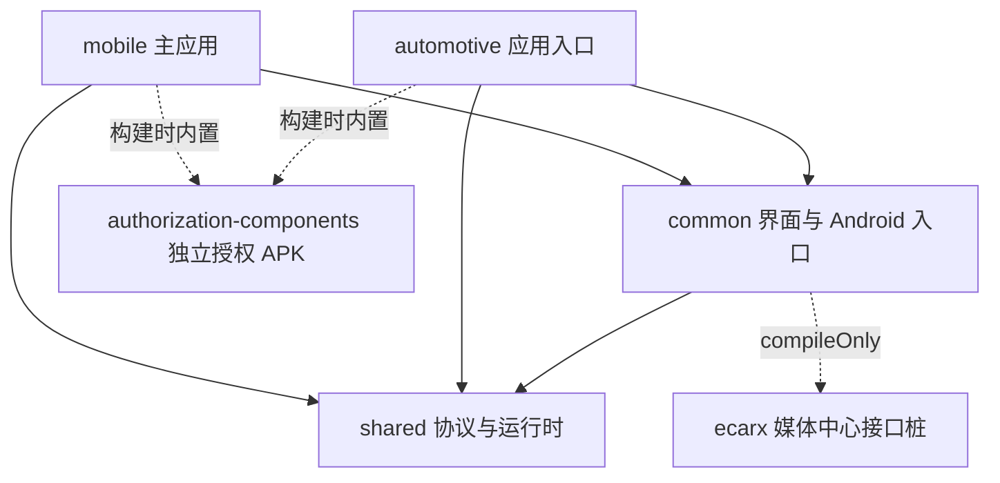

# 工程结构与维护边界

本仓库只服务星瑞 E02。以下描述代码职责，不代表连接、厂商接口或授权流程已经通过实车验证。

## 模块依赖

`common` 使用 `implementation` 依赖 `shared`；需要协议或运行时类型的应用直接声明 `shared` 依赖。`samples/home` 和 `samples/maphost` 是独立宿主示例，不作为其他车型适配分支。

## 界面与配置

- `SettingsInformationArchitecture` 定义设置分类和卡片归属。分类过滤仍由 `DiPlayActivity` 的 `filteredSection` 统一执行。
- 设置页按分类直接导航；按用户要求已移除搜索入口、索引、结果弹窗及专用资源。
- `AuthorizationSettingsCard` 只接收状态快照和显式动作；渲染不准备 VPN、不发起授权。`AuthorizationExportCoordinator` 管理导出权限、重复点击、后台结果及页面销毁后的回调失效；Activity 只连接系统权限入口与 UI。
- `CarPlayQuickMenu` 管理投影快捷菜单的渲染，接收返回首页、设置、画面调整、退出和音量操作，不持有连接控制器。布局尺寸、间距和触摸行为沿用原值。
- `AudioSettingsControls` 管理音频方案、焦点和缓冲控件，通过 `SettingsCardUi` 复用原有主题、尺寸和对话框行为。保存后仍由 Activity 显示重连提示或处理用户确认。
- `AdvancedMediaSettingsCard` 独立渲染实验性媒体卡片，继续使用原有重连确认和权限检查。
- `SettingsButtons` 保留统一按钮绘制和文字对齐；新增卡片不另建尺寸或圆角体系。
- `CarPlayTouchController` 管理触摸序列、画面外按下的抑制和设置手势。窗口测量只用于显示和触摸映射。
- `CarPlayBackgroundSession` 管理进程内会话交接、持有者和关闭完成回调；后台返回仍经过原有清理屏障。

`AirPlayPersistence` 是稳定调用入口，具体读写分别交给 `settings/` 中的 Audio、Connection、Display、Overlay、Identity 存储。`AirPlayPreferenceKeys` 是既有键名的来源；首轮拆分没有修改存储格式、默认值或有效范围。第二轮修正小窗卡片 x/y/size 的继承冲突：未保存时独立默认 80/25/40，已有小窗保存值优先；透明度继续沿用既有回退规则。没有新增迁移逻辑。备份仍使用显式允许列表，不能从所有键名自动推导允许导出的内容。

`OverlaySettingsChanges` 提供可注销的多订阅通知，存储层不反向引用 `AirPlayPersistence`。通知在保存线程同步执行，不持有注册表锁；UI 订阅者负责切换 UI 线程并在生命周期结束时关闭订阅，关闭不影响其他订阅者，已经执行中的回调可以完成。

## 连接与媒体

- `ConnectionRequestGate` 管理自动启动请求的代次和暂停状态。取消后恢复不会使旧回调重新有效。
- `UsbConnectionPriority` 管理当前线缆的尝试、失败、取消和手动无线选择。`UsbAutoConnect` 负责实际 USB 发现、广播和启动 Intent。
- 启动请求代次与线缆代次分别防护不同事件，不能省去任意一层；有线活动会话优先、失败后显式选择无线、物理重插恢复优先级等规则保持独立验证。
- `CarPlayServiceBindings` 持有控制器申请的 VPN/socket 服务绑定。解绑会唤醒等待线程；关闭或解绑后的迟到连接回调不能重新取得服务。NCM/TUN/socket 的实际停止与关闭顺序仍由控制器及对应服务管理。
- `WirelessHotspotLease` 持有本控制器的热点管理器及已确认信息，负责申请、复核复用、失效重建与释放／手动断开保留。复用原有无线资源锁和代次取消判断；控制器继续决定传输资源清理顺序，NCM/VPN 不移入此组件。
- `CarPlayStatus` 是连接编排到界面的状态边界。`CarPlayController` 继续协调有线和无线主流程；后续拆启动阶段时必须保留会话代次、失败停止和资源关闭顺序。
- `AndroidMediaSink` 协调媒体输出。焦点、视频解码、音频渲染、离屏输出和解码策略分别放在独立文件；已有锁、线程、队列和释放顺序保持原实现。

第三方 Concentus 与 SpeexDSP 源码继续保持原来源和许可证边界。

## 分发与验证

`gradle/carplay-distribution.gradle` 是主应用签名、认证资产限制和授权组件内置的共享规则。`mobile` 和 `automotive` 均接入，保留各包已有 `versionCode`，开发版本为 0.1.1。

授权组件的 `prepareDistributionAssets` 任务集中构建后的签名与校验，每个应用的 `prepareAuthorizationAssets` 只同步已校验资产。因此两个应用并行构建时不会同时写同一个签名产物。平台签名输入仍只保留本地忽略目录，构建不会安装或自动授权组件。

CI 包含授权组件单元测试和授权打包脚本测试。日常修改继续只做定向验证；只有明确要求打包才构建 APK，只有明确要求完整测试才执行完整 CI 任务。验证命令和实车范围见 [TESTING.md](TESTING.md)。

## 首轮结构调整的定向验证

- 媒体及视频等首轮定向测试 120 项通过；服务绑定的最终 3 项测试通过。
- 最终界面、显示、VPN 授权和音频焦点回归 208 项通过；连接请求状态新增 5 项测试通过。
- 授权打包脚本 22 项测试通过，公共文件检查通过。
- 两个应用入口的构建依赖图检查通过，组件签名任务仅出现一次；没有执行 APK 打包、签名、安装或完整 CI。
- 扩展存储检查发现既有 `ClusterTurnCardPersistenceTest.smallWindowCardKeepsIndependentDefaultsAndPosition` 与原实现冲突：小窗未保存独立位置时，原代码会使用主叠加层保存的位置，测试期望 80，实际为 60。首轮 188 个存储方法的实现已核对保持一致，当时该失败未计为通过。第二轮已按独立位置和大小的测试约定修正实现，保留显式保存的小窗配置。

## 第二轮结构调整（2026-10-20）

新增组件的定向行为测试直接覆盖导出重复请求与迟到回调、订阅独立释放、热点复用与取消。Activity 集成测试保留页面导航、授权和会话生命周期验证；仍需操作旧控制器内部状态的集成夹具暂保留反射，不通过扩大生产 API 暴露范围来迁就测试。

本轮没有改变快捷菜单布局、星瑞默认音频方案、USB 优先级、VPN 授权边界或热点开关规则。没有打包、签名、安装 APK，也未运行完整 CI；验证结果以本轮定向测试为准，不代表实车验证。

第二轮最终定向回归：shared 4 项、common 239 项，共 243 项通过（0 失败、0 错误）。公共文件检查和忽略换行差异的补丁检查通过。

## 移除设置搜索（2026-10-20）

按用户要求移除搜索入口、编辑框、结果弹窗、搜索索引、控件定位标签和专用图标／文案。分类栏和紧凑分类条继续直接导航；返回键直接返回首页。其余第二轮结构修改继续保留。

补充预览位于本地忽略目录 `agent_docs/screenshots/remove-settings-search/`，为中文 Robolectric/API28 原生渲染图，1920×720 横屏、字体 150%；宽屏使用星瑞默认 160 dpi，紧凑场景使用 480 dpi／界面大小 100%。这些图片不是已安装 APK 或实车截图。

按用户最新要求，后续界面验证只使用中文，移除现有阿拉伯语／RTL 专项用例、文案替换夹具及截图生成分支；保留中文宽屏、紧凑、高密度和大字体检查。语言固定中文的回归仍使用非中文系统配置检查强制中文行为，不再使用阿拉伯语场景。

本轮定向验证累计 294 项通过（common 290 项、授权组件 4 项）；紧凑弹窗夹具修正后相关 21 项复核通过。未运行完整 CI，未打包、签名或安装 APK。

2026-10-20 后续按用户打包请求完成测试 APK 0.1.1 / 97（内置授权组件 8），主签名和组件完整性核验通过，并覆盖安装到 API 34 模拟器 `emulator-5558`；本次打包未追加测试或完整 CI。以上“未打包”保留为各源码阶段的历史验证范围，交付记录见 [授权组件与构建核验](ANDROID9_AUTHORIZATION_COMPONENTS.md)。
