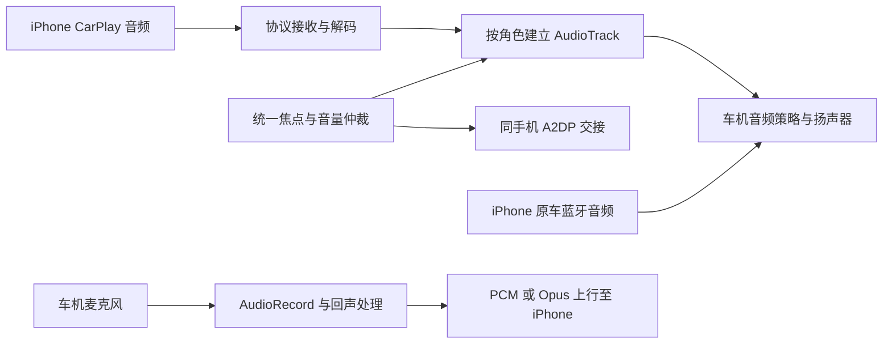

# huangwits/DiPlay-Preface 音频设计分析

2026-10-19。分析固定于当前 main 提交 [`6bce291fc6a603dd1f11554dc2dbd15886d18df1`](https://github.com/huangwits/DiPlay-Preface/commit/6bce291fc6a603dd1f11554dc2dbd15886d18df1)，提交时间 2026-10-17。README 仍标注 0.2.20.1，不能把 main 后续改动当成另一个已发布版本。本仓库此前选择性参考的源码为 `e59ca212150175bfd804701901252084a42f7caf`，见 `GEELYPLAY_BLUETOOTH_0.2.20.1.md`。

本次仅分析代码和记录结论，不修改应用音频实现，不构建、不运行测试、不安装 APK。固定来源和关键文件 SHA-256／行号在本机忽略目录 `agent_docs/downstream-audio-review-2026-10-19/`。

分析后的完整源码副本已清理；来源与 evidence.json 保留，可从本机 upstream/huangwits-v0.2.20.1 仓库按上述提交重新读取。

## 核心设计

默认主路径是按音频角色分流播放，并由一个焦点协调器仲裁。它并非默认把所有声音交给原车蓝牙，也不是将所有角色强行合到音乐通道。Host 固定开启 unifiedMediaOutput，但仍传入独立的 AudioStreamRoutes；“统一”主要体现在角色识别与管理。

### 播放路由

| 角色 | 默认 legacy stream | 策略 |
| --- | --- | --- |
| 音乐 | 3 | 独立缓冲，持续播放焦点 |
| 电话／铃声 | 6 | 临时焦点，压制其他角色 |
| Siri | 9 | 临时焦点，实际语音优先 |
| 导航 | 10 | 瞬时可压低焦点，或交给原厂混音 |

来源：[AudioStreamRoutes.kt](https://github.com/huangwits/DiPlay-Preface/blob/6bce291fc6a603dd1f11554dc2dbd15886d18df1/shared/src/main/java/com/geelyplay/preface/media/AudioStreamRoutes.kt#L6)、[Host 连接时配置](https://github.com/huangwits/DiPlay-Preface/blob/6bce291fc6a603dd1f11554dc2dbd15886d18df1/common/src/main/java/com/shilapi/xcertplay/CarPlayHostActivity.kt#L4134)。

AUTO 用 -1，与有效 stream 0 区分。用户显式 stream 优先；配置具体输出设备时改走 usage／设备选择。legacy AudioTrack 被 ROM 拒绝时退到标准路径，API 22 有旧构造器回退。编码播放包含 LPCM、AAC 和软件 Opus，最终落到 PCM16 AudioTrack。

这些数字是参考项目的默认路由，不能推断为 E02 的通道定义。本仓库媒体／导航 3／12 及已保存的用户选择继续优先。实现位置：[AndroidMediaSink.kt:1914](https://github.com/huangwits/DiPlay-Preface/blob/6bce291fc6a603dd1f11554dc2dbd15886d18df1/shared/src/main/java/com/shilapi/xcertplay/media/AndroidMediaSink.kt#L1914)。

### 焦点和混音

AudioFocusCoordinator 管理活动输出和麦克风请求，车机路径按电话、铃声、Siri、导航、音乐的优先级选择当前焦点。永久焦点丢失会抑制音乐，重复元数据不应重新抢回；系统外部通话优先。旧请求回调通过代际过滤。

非原厂混音路径的导航压低系数为 0.2；通话／Siri 等实际 PCM 到达时还会触发缓冲时长加 900 ms 的语音优先窗口。需要区分两件事：语音活动有 PCM 截止时间，而导航本地压低条件读取的是活动导航 AudioTrack 的存在，renderer 在等首包之前便申请焦点。因此，“协商后长期保留但暂不发声的导航轨是否持续占焦点／压低音乐”是静态代码暴露的验证点，不能等同于已发生的实车故障。

参考：[AudioFocusCoordinator.kt:211](https://github.com/huangwits/DiPlay-Preface/blob/6bce291fc6a603dd1f11554dc2dbd15886d18df1/shared/src/main/java/com/shilapi/xcertplay/media/AudioFocusCoordinator.kt#L211)、[音量应用逻辑](https://github.com/huangwits/DiPlay-Preface/blob/6bce291fc6a603dd1f11554dc2dbd15886d18df1/shared/src/main/java/com/shilapi/xcertplay/media/AudioFocusCoordinator.kt#L264)。

发现系统蓝牙包 ecarx.bluetooth.service 后，导航设置会读写系统 NAVI_MIX_SWITCH，并把压低交给原车混音器；应用不再叠加本地 20% 衰减。仅有包存在和系统键读写成功不能证明 E02 的实际混音语义，不能替换本仓库“实际导航发声时仅把本应用音乐降至 30%”的 Linkco 流程。来源：[NavigationAudioDuckingSettings.kt](https://github.com/huangwits/DiPlay-Preface/blob/6bce291fc6a603dd1f11554dc2dbd15886d18df1/common/src/main/java/com/geelyplay/preface/NavigationAudioDuckingSettings.kt#L8)。

### 原车蓝牙交接

BluetoothAudioHandoff 只针对同一部、仍配对的手机操作 A2DP sink profile 11。它查询实际播放状态，不把连接当播放；获得 CarPlay 音频归属后可反射断开该手机的音乐 profile，交还时只恢复本应用断开的连接。多个所有者通过共享租约避免提前恢复，退出恢复有五秒界限。通话／语音通信时延后音乐交接，接口失败记录原因。

需要特别注意目前源码的两套配置：

| 配置 | 影响位置 |
| --- | --- |
| car_bluetooth_audio | Host 的 disableAudioOutput，撤下 CarPlay 音频格式和 feature |
| vehicle_audio_routes.bluetooth_output | sink 的原车播放反馈、控制器的 A2DP 交接与媒体焦点策略 |

两者默认均为 false。对当前 main 的主源码搜索，没有找到 saveCarBluetoothAudio 或 VehicleAudioOutputMode.setBluetooth 的调用方，只有定义和读取：不能把保留的蓝牙路径描述成已经接通的界面开关。若外部保存值只开启前者，就可能出现“不接收 CarPlay 音频，却仍按非蓝牙交接策略运行”的组合。

另外，蓝牙关闭 CarPlay 音频公告时，/info 的资源列表仍包含屏幕 1 和主音频 2。这是与音频能力声明需要联合验证的边界，并不证明它就是自动暂停的根因。

参考：[交接实现](https://github.com/huangwits/DiPlay-Preface/blob/6bce291fc6a603dd1f11554dc2dbd15886d18df1/shared/src/main/java/com/shilapi/xcertplay/vehicle/BluetoothAudioHandoff.kt#L103)、[控制器配置](https://github.com/huangwits/DiPlay-Preface/blob/6bce291fc6a603dd1f11554dc2dbd15886d18df1/shared/src/main/java/com/shilapi/xcertplay/orchestration/CarPlayController.kt#L2682)、[第二配置定义](https://github.com/huangwits/DiPlay-Preface/blob/6bce291fc6a603dd1f11554dc2dbd15886d18df1/shared/src/main/java/com/shilapi/xcertplay/vehicle/VehicleAudioOutputMode.kt#L6)、[资源声明](https://github.com/huangwits/DiPlay-Preface/blob/6bce291fc6a603dd1f11554dc2dbd15886d18df1/shared/src/main/java/com/shilapi/xcertplay/airplay/AirPlayInfoPlist.kt#L101)。

本仓库此前已移植同手机交接、共享恢复与真实播放反馈；当前以同一连接快照统一蓝牙模式，并在蓝牙模式只申请屏幕资源。没有发现该下游当前 main 在这些方面新增可直接移植的自动暂停修复。

### 麦克风与通话

AudioRecord 按原厂音源、通话和语音识别角色选择输入，候选源必须成功开始录音才算可用。上行可使用软件 Opus，缺少平台编码器时仍能工作；可选 Speex 回声消除会尝试关闭平台 AEC，不能关闭时放弃叠加，避免两套回声处理互相干扰。通信模式使用进程内租约，只恢复自己申请的模式／SCO。

FS11G／API22 有独立的 MIC、PCM16 读样本和音源顺序修正；它针对旧平台采样异常，不能移植为用户 Android 9 E02 的默认策略。见 [MicrophoneUplink.kt:75](https://github.com/huangwits/DiPlay-Preface/blob/6bce291fc6a603dd1f11554dc2dbd15886d18df1/shared/src/main/java/com/shilapi/xcertplay/media/MicrophoneUplink.kt#L75)。

独立 MicrophoneHealthCheck 是较值得借鉴的增量：检查采样率和音源能否启动、读取是否持续，并计算 RMS、峰值和削顶比例，不保存原始录音。它是诊断，不是自动找出音质最佳的输入配置；Host 当前主要以无 CarPlay 会话作为准入。若引入 E02，还应加入系统通话／录音占用与用户取消检查。见[健康检查](https://github.com/huangwits/DiPlay-Preface/blob/6bce291fc6a603dd1f11554dc2dbd15886d18df1/common/src/main/java/com/geelyplay/preface/media/MicrophoneHealthCheck.kt#L67)。

## 相比此前参考版本的变化

固定比较 e59ca212 → 6bce291：

- 音乐默认缓冲从 500 ms 回到 300 ms，预设 100–1000 ms；Host 读取一个共享值，有线／无线不是本仓库那样的独立保存设置。
- 移除 MediaClockTrim 和 AudioTrack 播放速率微调；仍有欠载后的暂停／重新预缓冲。音频队列最多 192 包，满时丢新包，没有本仓库刚合入的压缩积压识别与过期包保护。
- 增加独立麦克风健康检查；麦克风核心采集在本次比较中仅出现重复注释，没有新的采集行为修改。
- SoftwareOpusEncoder.encode 仍只捕获 Exception，没有本仓库选择性同步 #866 的 AssertionError 保护。

缓冲证据：[MediaAudioBuffer.kt](https://github.com/huangwits/DiPlay-Preface/blob/6bce291fc6a603dd1f11554dc2dbd15886d18df1/shared/src/main/java/com/shilapi/xcertplay/media/MediaAudioBuffer.kt#L9)。Opus 证据：[SoftwareOpusEncoder.kt:32](https://github.com/huangwits/DiPlay-Preface/blob/6bce291fc6a603dd1f11554dc2dbd15886d18df1/shared/src/main/java/com/shilapi/xcertplay/media/SoftwareOpusEncoder.kt#L32)。

这些变化不能据此推出其长期同步更稳定，或删除时钟微调更适合 E02。本仓库 #814 与 #866 修正应继续保留，除非有本车时钟偏移、队列延迟或编码故障证据要求调整。

## 与本仓库的关系和建议

| 方面 | 下游当前设计 | 本仓库应保持的差异 |
| --- | --- | --- |
| 默认输出 | 音乐／电话／Siri／导航 3／6／9／10 | 星瑞 E02 媒体／导航 3／12，用户配置优先 |
| 导航混音 | 原车混音器或本地 20% | Linkco 实际 PCM 驱动，本应用音乐 30% |
| 蓝牙路径 | 两份独立配置，主 UI 未找到写入方 | 同一连接快照、明确模式、有限恢复与现有授权组件 |
| 延迟处理 | 300 ms 共享缓冲，已移除时钟微调 | 分有线／无线设置，积压保护和修正后的时钟微调 |
| 方控／音源 | MediaSession 和按键转发 | 继续核对 E02 原厂媒体中心 ready、注册及 requestPlay |
| 麦克风诊断 | 已有独立健康检查 | 可选借鉴，补充 E02 运行状态和取消检查 |

对其 Kotlin／Java 主源码搜索，未找到本仓库 PrefaceMediaCenter 所用的 ECARX MusicClient／requestPlay 注册链；MediaSession 激活不能替代厂商音源所有权。因此不能将其方控转发直接当成“切歌不跳原车媒体页”的解决办法。

建议后续优先顺序：先借鉴独立麦克风诊断和音频状态取证；保留已移植的蓝牙交接安全边界；继续验证本仓库实际媒体焦点与原厂音源就绪情况。不要整包替换混音器、引入 E01 通道默认值、写入未经核实的系统混音键，或照搬 FS11G 录音特殊分支。

上述为静态设计分析和差异判断。参考 E02 固件身份仍为 IHU519G / FS11A1 / Android 9 / API28 / 构建 327，OTA SHA-256 `f61a7399d61a7f4502b9289ea6c49c661c39c459aae81e676722bcf9be913c01`；此前用户 IHU353G 日志和下游 E01 源码不能替代当前车机验证。本次没有新增固件接口可用性结论。
