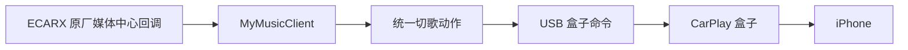

# Linkco APK 切歌与原厂媒体中心参考

分析日期：2026-10-15。输入与文件校验见 [无线参考](LINKCO_APK_WIRELESS_REFERENCE.md)。用户明确确认：**在同一台星瑞 E02 上，这个盒子 APK 用方向盘切歌成功，且不会跳到原车多媒体页面**。这是有效的实车对照，但没有该 APK 当时的注册／焦点日志，仍不能单凭静态源码认定哪一条路径在实车生效。

## 2026-10-20 复核：此前遗漏的随包媒体授权

用户追问后重新检查原 APK，确认它不仅包含 MusicClient 注册代码，还在 manifest 声明 `eCarX_OpenAPI_AppId`、`eCarX_OpenAPI_AppKey`，并带有 `assets/license.txt`（1,536 字节，SHA-256 `af28b221b086f52dae1af7325885167cecba89d8bc1ad41d13a97a6606f59172`）。此前移植对照未把这项差异单独核验，是分析遗漏；不能将“复制注册代码后本应用仍被拒绝”作为第三方不具参考价值或只能停止调查的结论。

使用已缓存 OpenAPI 服务端 `f/d.java` 中的验证公钥及同样的包名／证书身份计算方式，在本机核验该授权文件，得到以下布尔结果：签名块有效、profile 的 AppId 与 APK 声明一致、包含 mediacenter 权限、允许第三方实际包名和实际签名、不允许当前 CarPlay 测试包及其实际签名。参考 APK 证书 SHA-256 为 `785e5cda14ae3f08e755c7087cfd9589fa79a98c8eaccb5894a1b0a30799bed8`，并非参考固件的平台证书。

服务端 `f/e.java:67–80` 读取 manifest 接入项及 assets 授权，`f/d.java:95–103,129–150,211–231` 核对包名、证书和授权项。这为第三方与本应用的准入差异提供了具体静态证据。授权解析仅在内存完成，只保存文件哈希和布尔核验结果到本机忽略目录 `agent_docs/vehicle-20261020-build97/linkco-admission-recheck.json`；未输出接入值或授权明文，未将第三方授权移植进主应用，未修改签名或系统服务。

**实际方向是补齐适用于本应用真实身份的媒体准入，并继续验证第三方运行时音源／方控路径，而不是继续只调整去重或把第三方授权文件直接搬过来。** 现有 E 盘日志只确认第三方已安装，没有取得它运行时 ready、token、requestPlay 的有效对照，故不能把本地授权核验当作当时不跳页的唯一原因已经证明。第三方同车成功仍是重要验收基线，当前尚无适用于本包并经实车验证的不跳页修复。

## 最值得借鉴的差异：注册为原厂媒体音源

本次 APK 的 `com.juyou.ecarx.ECarxManager` 实现了独立于 Android MediaSession 的 ECARX 媒体中心接入：

1. `App.java:158–163` 将当前构建标记为 linkco，并根据本 APK 启用的 ECarX 功能标记设置可用性。`com/juyou/app/b.java:25–27` 的 ECarX 标记为 true。`Controller.java:829–836` 调用 ECarxManager 初始化，不只是留在 APK 中的未引用类。
2. `ECarxManager.java:38–74` 检查运行时 SDK 类，取得 `MediaCenterAPI.get(context)`，要求该 APK 所用 SDK 版本大于 330；等待 `onAPIReady(true)` 后，使用自己的实际包名 `com.aufn.carplay` 和 `MyMusicClient` 调用 `registerMusic`，保存返回 token。版本检查是这个参考 APK 的行为，不是要求本项目用车型、Android 版本或构建号作为默认启用门槛。
3. `ECarxManager.java:96–111` 在有可用 API 和 token 时调用 `requestPlay(token)`；返回 true 后发布媒体列表、sourceType 6 和播放状态。`Controller.java:1288–1300` 的音频数据路径会调用它。这不仅仅是申请 Android AudioManager 焦点。
4. `MyMusicClient.java:30–55` 实现 `onNext()`／`onPrevious()`，返回 true，并把原厂回调送入统一动作分发。`MyMusicPlaybackInfo.java:82,96–109` 返回本应用包名、播放状态、sourceType；其 launch PendingIntent 指向自己的 CarPlay Activity，而不是原车音乐页面。

参考 APK 可确认的回调后链路：

方向盘到原厂媒体中心的具体运行时路由、SDK 就绪与 token 是否成功取得，没有从用户车机抓取日志。**“已注册的原厂媒体音源”是当前最值得验证的候选差异，不是已完成因果证明。**

## 切歌映射、按下／释放和去重

完整反编译缓存位于 `agent_docs/apk-reference/linkco-1.9.1.63.2330/decompiled/`，下表路径相对于其 `sources/`。这些属于参考盒子的协议，不是可向 iPhone 直接发送的 Android／CarPlay HID 编号。

| 接入／转发位置 | 静态行为 | 证据 |
| --- | --- | --- |
| 原厂媒体中心回调 | 下一曲 `EcarxKey7` → 统一动作 3；上一曲 `EcarxKey8` → 动作 2 | `com/juyou/ecarx/MyMusicClient.java:30,48`；`com/juyou/app/utils/g.java:44–49` |
| Android 标准媒体键 | 87 → 动作 3；88 → 动作 2，与本项目识别的标准键一致 | `com/juyou/app/Controller.java:2099–2107`；`com/juyou/app/utils/g.java:14–19` |
| MediaSession | 在媒体键 ACTION_DOWN 时分发，接受后返回 true；系统音频焦点 gain 激活会话、永久 loss 取消激活 | `com/juyou/app/service/CoreService.java:148–176,250–284` |
| 广播入口 | DWKeyReceiver 接收 MEDIA_BUTTON 并进入 EventBus；动态 WheelKeyReceiver 只对有序广播 abort。普通广播无法阻止其他接收者 | `com/juyou/app/receiver/DWKeyReceiver.java:16–34,64–77`；`WheelKeyReceiver.java:92–98` |
| 统一分发 | EventBus 事件转换成动作；Controller 对相同已排队动作合并，以 500 ms 延迟执行 | `com/juyou/app/service/CoreService.java:387–401`；`Controller.java:2129–2141` |
| 盒子命令去重 | 相同动作间隔小于 50 ms 时忽略 | `e0/b.java:631–650` |
| 盒子切歌按下／释放 | 上一曲发 `media_key(2)`、约 100 ms 后发 0；下一曲发 `media_key(3)`、约 100 ms 后发 0 | `e0/b.java:664–687`；`a0/a.java:869–892` |

原厂切歌回调与 Android 媒体会话／广播是并行入口，不是盒子 APK 完全不接收普通媒体键。500 ms 合并和 50 ms 去重不能证明抑制了原车页面，也不能保证长按、快速多次按键与多来源事件都严格一一对应。本项目已有按下／释放配对及私有回调／广播 750 ms 成对去重，不应为了模仿盒子把窗口改成 50 ms，或把每次切歌延迟 500 ms。

还有一项不能照搬：`MyMusicClient.onPlay()` 与 `onPause()` 都映射为统一切换动作 8，`g.java` 的 EcarxKey4／5 映射与其一致。本项目已因播放后自动暂停问题明确区分 PLAY／PAUSE，若接入原厂回调，必须继续保持这一区分，不能将两个回调都改成 toggle。

## 星瑞参考固件中是否存在相同接口

这一步针对已提供的 **IHU519G / FS11A1 / Android 9 / 构建 327**，OTA SHA-256 仍为 `f61a7399d61a7f4502b9289ea6c49c661c39c459aae81e676722bcf9be913c01`。用户报告设备是 IHU353G，因此这里只确认参考固件中的定义，不能替代当前车机实测。

已从缓存 system.img 提取并索引 `system/framework/boot-ecarx.gkui.openapi.impl.vdex`。原 JAR 仅 217 字节，不能因为 JAR 无实现就判定接口不存在。CompactDex 的 class/method/proto 定义确认：

| 接口定义 | 类定义或方法体在 VDEX 中的绝对字节偏移 |
| --- | --- |
| `com.ecarx.sdk.mediacenter.MediaCenterAPI` | class definition 194452；`get(Context)` 280476 |
| `MusicClient`，包含 `onNext/onPrevious/onPlay/onPause` | class definition 194932 |
| `MediaCenterAPIImpl.init(Context, ECarXApiClient.Callback)` | 285128 |
| `registerMusic(String, MusicClient)` | 285468 |
| `requestPlay(Object)` / `unregister(Object)` | 286068 / 286330 |
| `updateCurrentSourceType(Object, int)` | 287076 |
| `updateMusicPlaybackState(Object, MusicPlaybackInfo)` | 287768 |

另有 `IMusicClient`／`IMusicPlaybackInfo` interface 定义和对应 `registerMusic`／`updateMusicPlaybackState` 重载，可作为后续无打包厂商 SDK 的反射接入候选；不能只看到重载就确认当前车机允许调用。

本地 `catalog/media-center-classes.json` 保存定义、签名与偏移，`catalog/media-center-invokes.json` 保存有限的调用观察，可运行 `python agent_docs/firmware/inspect_media_center.py` 重建。优化方法含 quickened 指令，目前脚本对所选方法的完整指令边界验证未通过，**没有将其结果当成注册准入、权限、内部路由或 SDK 完整实现的证明**。`XSFMediaCenter.apk` 反编译只恢复资源与少量库类，其实际实现主要保存在 VDEX，不能把 jadx 无报错当成完整业务实现已恢复。

媒体中心 manifest 声明 `ecarx.oem.permission.OPENAPI_MEDIACENTER_PERMISSION` 为 `0x12`（signature／privileged）。这不单独证明所有 SDK 方法都要求它，也不证明本项目可以注册。仍需核对当前车机的 SDK 版本／可用签名、API ready、实际包名下 token 非空、requestPlay 返回值与当前音源。不能冒充盒子包名、导入盒子签名、复制厂商凭据或随意猜 Binder 事务号来绕过检查。

## 对当前项目的结论与接入边界

接入前，`CarPlayMediaKeys` 主要提供 Android MediaSession、AudioManager 焦点、原厂媒体广播和输入观察者，再向 iPhone 发媒体 HID，没有原厂媒体中心注册 token／MusicClient 回调路径。输入观察者不是第三方独占接口，因此曾出现“切歌成功，同时原车媒体处理并跳页”。

本轮按用户要求默认接入原厂媒体中心音源注册，代码边界如下：

1. 以本应用实际包名注册，等待 API ready；只在注册成功且有真实 CarPlay 会话时接受回调。失败保留现有接入并记录具体阶段，不能报已接管原厂按键。
2. 只在用户开始／恢复 CarPlay 媒体播放且运行条件允许时申请原厂播放音源；同步真实播放／暂停状态，不通过定时重复 requestPlay 抢回原车收音机或其他音乐应用。通话、Siri／蓝牙音频及现有焦点规则继续保留。
3. 原厂 onNext／onPrevious 继续转本项目 NEXT／PREVIOUS；onPlay／onPause 分别转 PLAY／PAUSE，保持 HID 按下／释放机制。
4. 原厂回调与现有 304/305、87/88、MediaSession 分发需要统一去重，避免注册后一次按键变成两三次切歌；失败的发送不能吞掉后续有效路径，连续快速按键不能合并丢失。
5. 断开与控制器替换注销旧 token，并隔离迟到回调。不可通过普通广播 abort、不断强拉 CarPlay 前台或隐藏原车播放器来代替音源路由。

验收必须在用户同一台星瑞 E02 完成：播放／暂停各一次、前后台上一曲／下一曲、连续快速切歌、Siri／通话、切到收音机后的方控归属、回到 CarPlay、退出／断开后的释放，并核对无原车跳页／无自动暂停。盒子在同车不跳页是参考基线，不等于本仓库新包已经通过这些场景。

### 2026-10-15 默认接入实现

`PrefaceMediaCenter` 管理就绪、注册、播放申请和注销；`PrefaceMediaCenterBackend` 通过车机已有的 `IMusicClient`／`IMusicPlaybackInfo` 接口重载和 Java Proxy 接入，没有打包厂商 SDK。初始化使用本应用 Context，旧接口由 SDK 确定调用包；播放信息的包名为本应用，launch PendingIntent 指向本应用 CarPlayHostActivity。不冒用盒子包名，不使用 SDK 版本号作为启用门槛；缺少接口重载、权限拒绝、空 token 或 requestPlay 拒绝均记录阶段并保留原路径。

只有真实开始／恢复播放且会话、焦点、通话、蓝牙及语音优先状态允许时申请音源，播放位置刷新和归属轮询不重复 requestPlay。sourceType 6、播放状态 1/0 来自参考 APK 的观察值，仍需当前固件验证。断开立即禁止旧回调，串行队列注销旧 token 后再注册新控制器；IPC 期间失去归属会使迟到结果失效。

原厂回调、私有输入观察者、标准媒体键和 MediaSession 切歌控制共用 750 ms 跨来源去重；同一来源连续两次仍发送两次。物理 PLAY_PAUSE 与原厂明确 onPlay/onPause 的同次回调也配对，避免先播放又被切换暂停；明确 PLAY 与明确 PAUSE 不合并。没有引入盒子 500 ms 延迟。

**图示“方控按媒体播放状态调节音量”开关仅控制音量选流；原厂切歌默认接入不读取此开关，关闭它也不会关闭切歌。** 未新增 ADB、无障碍或权限设置入口。

同日补充 [歌曲信息、播放进度与歌词边界](PREFACE_MEDIA_METADATA.md)：基础歌曲信息同步，位置刷新改用可选的独立进度推送；保留动态标题更新。原厂接口有歌词定义，但当前 iAP2 链路没有独立歌词输入，CarPlay 画面可见歌词不等同于已收到歌词文本，不把本次实现描述为完整歌词同步。

38 项定向测试通过（`PrefaceMediaCenterTest` 11、`PrefaceMediaCenterBackendTest` 2、`PrefaceMediaKeyEchoesTest` 8、`CarPlayMediaCallbackTest` 10、`CarPlayMediaOwnershipTest` 7），覆盖 API 就绪、拒绝／权限失败、音源失去与恢复、IPC 迟到、注销、反射接口回调、播放／暂停、四路去重及音量开关独立性。没有运行全量 CI；当前车机尚未验证本应用的原厂注册准入及切歌不跳页。此前的 **0.1.1-59 USB 诊断包不包含这次运行时接入**，本轮未重新构建 APK。

### 后续修订：默认采用盒子的具体类注册路径

用户要求采用相同实现后，默认路径改为本应用自己的 `MusicClient`／`MusicPlaybackInfo` 子类，并调用 `registerMusic(context.packageName, client)`。原厂 `onNext/onPrevious/onPlay/onPause` 分别送入原有四路去重与真实会话归属检查；播放信息提供本应用包名、CarPlay 启动 Intent 和实际歌曲／播放状态。正常开始／恢复申请播放成功后，按参考 APK 的顺序更新空媒体列表（sourceType=6）、当前音源、播放状态。手机播放列表尚未接入，空列表不冒充手机曲目队列。

新增 `ecarx-mediacenter-api-stubs` 仅包含根据已核对签名手写的三类编译声明，不含厂商实现、APK/JAR 或凭据。`common` 仅以 `compileOnly` 引用，单元测试单独以 `testImplementation` 引用；正式应用运行时使用车机 SDK 的父类实现。相关覆写方法通过 consumer rules 保留。参考签名仍来自本文件表格所列 IHU519G/FS11A1 327 VDEX；本轮没有把声明签名变为 IHU353G 准入已确认的证据。

运行时先验证具体类、构造函数、回调与两个重载，再加载应用子类。仅类／方法缺失或链接不兼容时保留旧 interface 路径；API 未就绪、注册空 token、权限拒绝或播放请求拒绝时不换重载反复注册，也不改用盒子包名。记录 `registrationPath=package-music-client`、可读取的 SDK 数字版本及 `ready=... phase=before-registration`；SDK 版本仅供诊断，不作为 E02 默认启用门槛。

与参考盒子仍有明确边界：本应用发布实际歌曲信息，并保留通话、Siri、蓝牙音频优先、跨来源去重和旧 token 注销保护；不会每个音频包都重复 requestPlay 抢回原车音源。`api-not-ready` 发生在注册前，因此采用相同注册重载本身不保证修复当前 SDK 就绪失败、蓝牙暂停或原车跳页。仍须在用户车机核对 `ready=true`、`registered`、`request-play-accepted` 和实际行为。

本轮 51 项定向测试通过：具体类路径 8、interface 及元数据 7、注册生命周期 11、按键去重 8、媒体回调 10、归属 7。核对 mobile Debug／Release runtime 依赖不包含声明模块，common AAR 中也没有 `com/ecarx/sdk/` 类定义；未构建新 APK，已交付 0.1.1-63 不含本轮修订。

### 后续修订：应用启动即初始化与注册

按用户要求，`DiPlayApplication.onCreate()` 在语言初始化后调用 `CarPlayMediaKeys.initialize(applicationContext)`。初始化使用后台串行队列，原厂 API ready 后立即注册，无需先进入连接页面或建立 CarPlay 会话。同一进程重复初始化幂等；没有 CarPlay 控制器时不建立 Android MediaSession、不申请音频焦点／requestPlay，也不消费原厂播放或切歌回调。

首次连接采用启动时已有的注册对象／token，包括 SDK 尚未 ready 的情况；不会在首次 attach 时注销再注册。回调发送前再核对当前控制器、当前注册对象、会话及焦点／通话等条件，避免启动阶段的全局回调捕获不存在的控制器。启动诊断保留最多 16 条，仅保存脱敏阶段消息，首次连接时补入会话日志，可在报告中看到启动时的就绪／注册结果。

断开或真正更换连接控制器时，仍关闭旧注册、注销 token 并阻止迟到回调；后续连接按原生命周期重新初始化。注册时机提前不改变播放音源申请时机：仍仅真实 CarPlay 播放开始／恢复且条件允许时申请，不在主页抢占原车蓝牙或收音机。

本次 33 项定向测试通过：启动注册 4、Application 启动入口 1、注册生命周期 11、媒体归属 7、媒体回调 10。未构建新 APK，已交付 63 包不含提前注册及前述具体类注册修订；API 未就绪与实际准入仍待车机验证。

### 用户要求完整复刻后的生命周期补齐

2026-10-15 已继续对照 SDK 创建顺序、初始化线程、进程单例、稳定播放记录、完整能力字段、异步按键分发及断开／重连，具体差异、来源和验证见 [完整链路对照](PREFACE_LINKCO_MEDIA_REPLICA.md)。本轮以此文为当前实现说明；上文“后台初始化、控制器替换时注销”描述此前实现，现改为主线程初始化及进程注册复用。当前仍未取得本应用在 IHU353G 上 ready=true 和切歌不跳页的实车证据。
